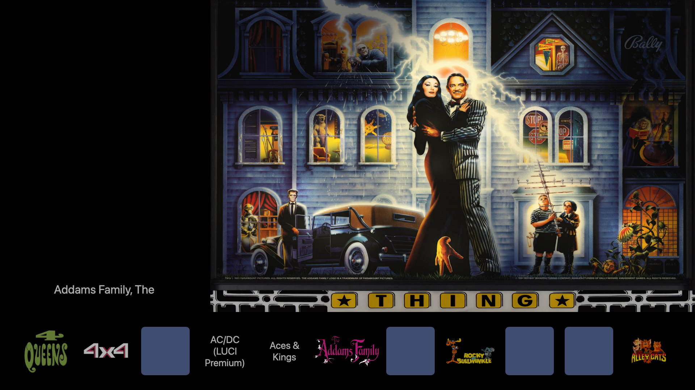

# Carousel2

A single screen desktop theme. The top four fifths of the screen show the table's cabinet
picture on the left and a large picture of the table beside it. A row of wheels runs along the
bottom with the selected one in the middle, larger and fully lit. A table with no picture of
the kind being shown is named where the picture would be, and a table with no wheel is named
in the row.



Requires VPinFE 3.0 or later (`min_vpinfe` in `manifest.json`). This is the 3.0 rebuild of
Carousel2, so its version is 2.0.0.

## What is here

```
manifest.json         name, version, author, min_vpinfe and the windows the theme draws
options.json          the options a person can change, with their defaults
index_playfield.html  the playfield page
style.css             the look
theme.js              the behavior
preview.png           shown in the theme list
```

## The two JSON files

JSON cannot carry comments, so what each field does is here.

`manifest.json`

| Field | What it does |
| --- | --- |
| `name`, `version`, `author`, `description` | Shown in the theme list. `version` is the theme's own release number |
| `preview_image` | The screenshot shown in the theme list |
| `type` | `desktop`: the theme is made for a single desktop screen |
| `min_vpinfe` | The oldest VPinFE that can run the theme |
| `windows` | The pages the theme draws. Carousel2 draws `playfield` only, so core's backglass and score view pages are used |
| `change_log` | A string, shown as "What's new" to someone installing or updating the theme |

`options.json` declares what a person can change under the theme's settings.

| Key | Type | Default | What it does |
| --- | --- | --- | --- |
| `maingfx` | select | `bg` | The large picture of the selected table. `bg` is the backglass, `fss` the full single screen, `table` the playfield, `wheel` the wheel, `cab` the cabinet and `dmd` the score view |

The key and its values are the ones Carousel2 had in 2.x, so a person's choice carries over.

## The four parts of theme.js

`theme.js` has four parts, in this order, each commented:

1. **Options** - read what `options.json` declared from `vpin.themeConfig`. `maingfx` is
   turned into the media kind core knows it by.
2. **The list** - the row of wheels. As many are drawn as fit across the screen, always an
   odd number so the selection stays in the middle, and they are drawn again when the
   window changes size. A table with no wheel picture is named instead.
3. **The selection** - draw the cabinet picture and the large picture. Both are still
   pictures, drawn by the theme: core's own media element shows a table's video whenever it
   has one, and this theme shows pictures. A table with no picture of the kind wanted is
   named in its place. In the collection picker the wheel row holds the collections and the
   large pane shows the selected collection's picture, or its name.
4. **Messages** - hand every message to core, then redraw.

## The page

| Element | What it holds |
| --- | --- |
| `#cab` | The cabinet picture, 30% of the width |
| `#main` | The large picture of the selected table, the rest of the width |
| `#wheels` | The row of wheels |
| `#empty` | "No tables found", shown when the list is empty |

The page's outermost element carries `vpinfe-upright`, so core can turn the whole page for a
cabinet screen mounted on its side. The stage is styled by class, not by id, so the rules in
`vpinfe-style.css` that size it for a turned screen still win. The pictures are stretched to
their boxes, not cropped, as they always were in Carousel2.

## What core does, so this theme does not

| Core handles | The theme's part |
| --- | --- |
| Keys, buttons and the remote: stepping, paging, the menu and the collection picker | Launch on `select` |
| Moving the selection and wrapping around the list | Draw the selected table (`activeList().current`) and the wheels around it (`indexAfter`) |
| Serving the table's media | Pick the kind for each pane, ask for it by name, and name the table when it has none. `table` falls back to the full single screen picture here, because `getImageURL` has no fallback |
| Audio for the selected table | Nothing |
| Preloading the neighbors | Nothing |
| Turning the page for a sideways cabinet screen | `vpinfe-upright` on the stage |
| The loading indicator while a table starts | Restyle `.vpinfe-launch-spinner` |
| Attract mode | Nothing |
| The backglass and score view pages | Nothing: Carousel2 ships none, so core's are used |

## Opt-outs

Carousel2 uses none. There is no `config.json`.
